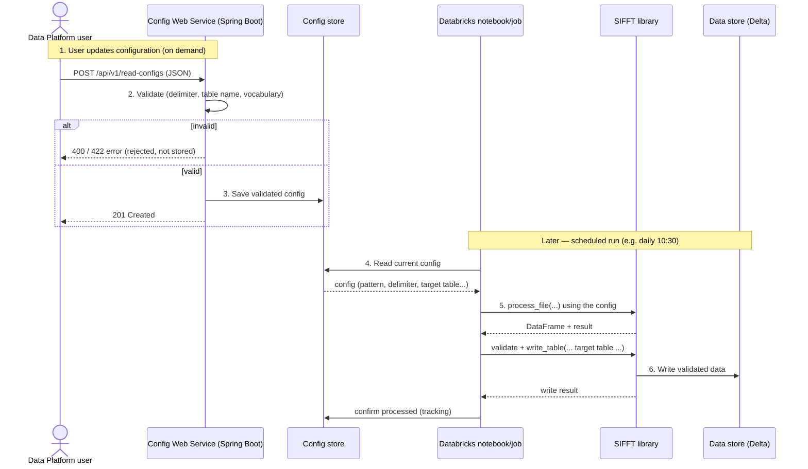

# End-to-End Sequence — Config Web Service + SIFFT

How a configuration change made through the web service flows through to data landing in the
store. The web service and SIFFT never call each other directly — they are joined only by the
**shared config store**.

## Mermaid sequence diagram

Paste into [mermaid.live](https://mermaid.live) and export PNG/SVG.



## ASCII fallback

```
 User            Web Service        Config store      Notebook        SIFFT         Data store (D)
  |                   |                  |                |              |                |
  |  1. POST config   |                  |                |              |                |
  |------------------>|                  |                |              |                |
  |                   | 2. validate      |                |              |                |
  |                   |---.              |                |              |                |
  |                   |<--'              |                |              |                |
  |                   | 3. save (if ok)  |                |              |                |
  |                   |----------------->|                |              |                |
  |  201 Created      |                  |                |              |                |
  |<------------------|                  |                |              |                |
  |                   |                  |                |              |                |
  |         - - - - - later: scheduled run (10:30) - - - - -            |                |
  |                   |                  | 4. read config |              |                |
  |                   |                  |<---------------|              |                |
  |                   |                  |--------------->|              |                |
  |                   |                  |                | 5. process + |                |
  |                   |                  |                |  write (SIFFT)|               |
  |                   |                  |                |------------->|                |
  |                   |                  |                |              | 6. write data  |
  |                   |                  |                |              |--------------->|
  |                   |                  |                |  confirm processed            |
  |                   |                  |<------------------------------|                |
```

## The six steps in words
1. **User updates config** — an HTTP request to the web service (new file type, changed delimiter, etc.).
2. **Web service validates** — bad config is rejected here (400/422) and never stored.
3. **Config saved** — valid config is persisted to the shared store; user gets 201.
4. **Scheduled job reads config** — later, the Databricks job reads the current config from the store (instead of hard-coded FILE_MAPPINGS).
5. **SIFFT processes** — the notebook uses that config to drive SIFFT: read file, validate, write table.
6. **Data lands** — SIFFT writes the validated data to Delta tables; the notebook records tracking.

## Scope note (state this honestly)
- **Built in the PoC:** steps 1–3 (the web service that validates and stores config).
- **Existing SIFFT system:** steps 5–6 (already in production, today reading config from code).
- **The small change not built:** step 4 — pointing the notebook at the config store instead
  of its hard-coded mappings. This is the integration "glue" and is out of scope for the PoC.
```
