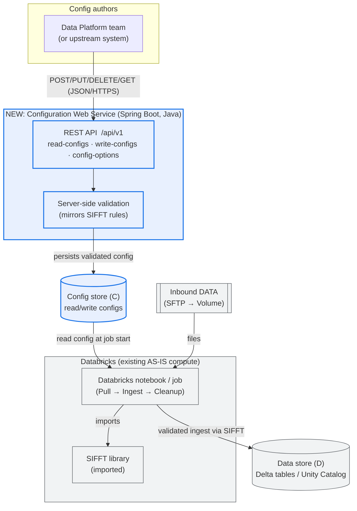

# SIFFT TO-BE Architecture — with Configuration Web Service

Digital rendering of Michal's hand-drawn "Proposal / Change", reconciled with the
production code and Fahad's three-config description.

## Mermaid diagram



## ASCII fallback

```
            ┌─────────────────────────────┐
            │  Data Platform team /        │
            │  upstream system (clients)   │
            └──────────────┬──────────────┘
                           │  HTTPS + JSON
                           │  GET / POST / PUT / DELETE
                           ▼
   ╔═══════════════════════════════════════════════╗
   ║   NEW: Configuration Web Service (Spring Boot) ║
   ║   /api/v1                                      ║
   ║     • read-configs                             ║
   ║     • write-configs                            ║
   ║     • config-options                           ║
   ║   ── server-side validation (SIFFT rules) ──   ║
   ╚═══════════════════════════╤═══════════════════╝
                               │ persists validated config
                               ▼
                   ┌───────────────────────┐
                   │  Config store (C)      │
                   └───────────┬───────────┘
                               │ read at job start
                               ▼
   DATA (SFTP→Volume) ───►  ┌──────────────────────────┐
                            │  Databricks notebook/job  │
                            │  Pull → Ingest → Cleanup  │
                            │     imports SIFFT lib     │
                            └───────────┬──────────────┘
                                        │ validated ingest
                                        ▼
                            ┌───────────────────────┐
                            │  Data store (D)        │
                            │  Delta / Unity Catalog │
                            └───────────────────────┘
```

## What changed vs AS-IS

| | AS-IS (today) | TO-BE (proposal) |
|---|---|---|
| Where config lives | In code (`FILE_MAPPINGS`, `TableWriteOptions`) | Externalised in a config store, managed via REST |
| Changing a feed | Code edit + Asset Bundle redeploy | One API call (POST/PUT/DELETE) |
| Validation of config | Implicit, at job runtime (fails the batch) | Explicit, server-side, at write time (bad config rejected) |
| Who can change it | Anyone with repo/deploy access | Controlled via API auth (Data Platform team) |
| SIFFT & Databricks | Unchanged | **Unchanged** — notebooks still import SIFFT and write Delta |

The scope of this assignment's web service is the **blue box and the config store**:
managing configuration. SIFFT, the notebooks and the Delta store are the existing
AS-IS and are not re-implemented.
```
